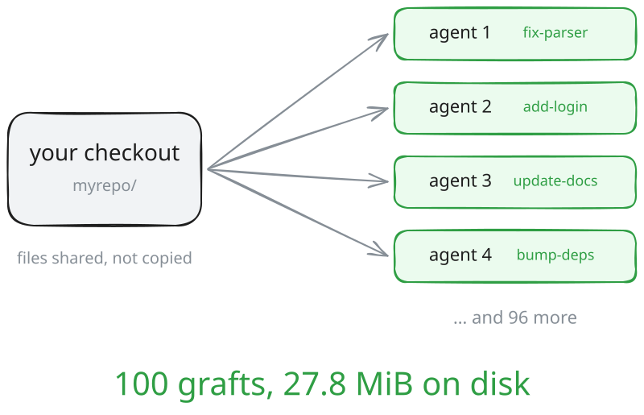
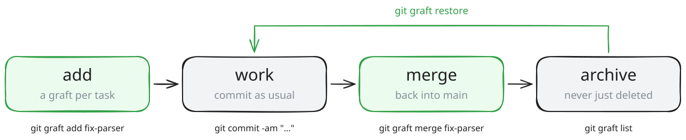
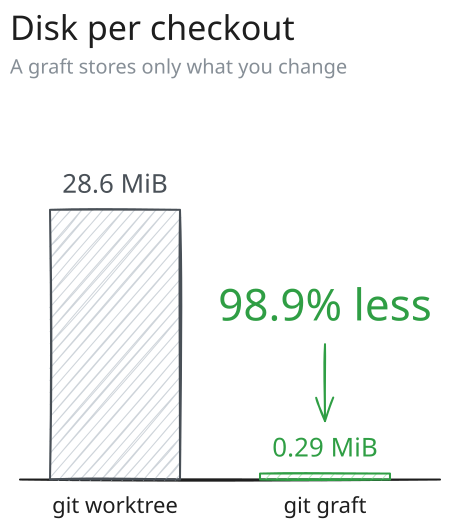
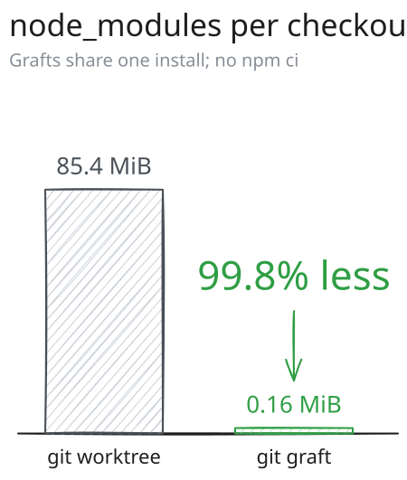
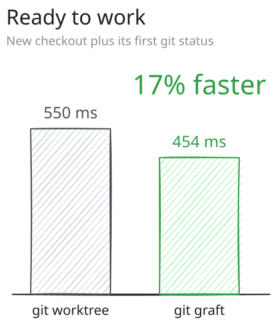
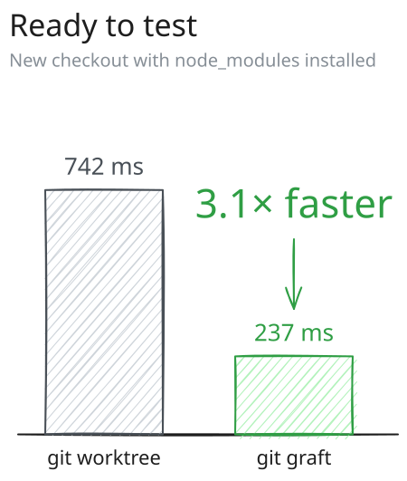

<div align="center">

# git-graft

**Run hundreds of coding agents on one repository without filling your disk.**

[](https://github.com/mprync/git-graft/actions/workflows/ci.yml)
[](https://github.com/mprync/git-graft/releases)
[](https://crates.io/crates/git-graft)
[](https://github.com/mprync/git-graft/releases)
[](LICENSE)
<br>
[](#where-it-works)
[](#hand-it-to-your-agents)
[](#hand-it-to-your-agents)
[](#hand-it-to-your-agents)
[](#hand-it-to-your-agents)
[](#install)

<br>

<picture>
  <source media="(prefers-color-scheme: dark)" srcset="docs/assets/hero.dark.svg">
  
</picture>

</div>

<br>

`git worktree` works fine until you have twenty agents going at once, each with a full copy of your files and its own `node_modules`. git-graft gives every agent a real, separate Git repository next to yours, but the files in it are clones that share disk with your checkout. A graft only takes up space for what it changes.

## Install

```sh
# macOS and Linux
curl -fsSL https://raw.githubusercontent.com/mprync/git-graft/main/install.sh | sh

# Homebrew
brew install mprync/tap/git-graft

# Windows (PowerShell)
irm https://raw.githubusercontent.com/mprync/git-graft/main/install.ps1 | iex
```

Scoop, Cargo and Linux packages are in the [install guide](docs/install.md). You'll need Git 2.46 or newer.

## How it goes

<p align="center">
  <picture>
    <source media="(prefers-color-scheme: dark)" srcset="docs/assets/lifecycle.dark.svg">
    
  </picture>
</p>

```sh
git graft add fix-parser                     # prints the graft's path and a lease
cd ../myrepo.graft/fix-parser
git commit -am "Fix the parser"
cd -
git graft merge fix-parser --lease <lease>
```

The lease is how git-graft knows a graft is yours, so treat it like a password. Merged grafts are archived rather than deleted, and `git graft restore` brings one back if you need it.

Install your dependencies once and every new graft gets its own writable `node_modules`, for almost no disk:

```sh
npm ci
git graft deps share --key node24
```

Need your `.env` too? Add `--include .env`. You can keep defaults like that, and setup hooks, in a [`.graftconfig`](docs/operations.md#configure-a-project).

## Hand it to your agents

git-graft comes with an MCP server. Point it at your repo:

```sh
claude mcp add git-graft -- git-graft --repo /path/to/project mcp
```

<details>
<summary>Codex, Cursor and other clients</summary>

<br>

Codex, in `~/.codex/config.toml`:

```toml
[mcp_servers.git-graft]
command = "git-graft"
args = ["--repo", "/path/to/project", "mcp"]
```

Cursor, in `.cursor/mcp.json`:

```json
{
  "mcpServers": {
    "git-graft": {
      "command": "git-graft",
      "args": ["--repo", "/path/to/project", "mcp"]
    }
  }
}
```

Anything else that speaks MCP over stdio works the same way: run `git-graft --repo <path> mcp`.

</details>

Each agent then makes its own graft, works in it and merges it back, and can't touch anyone else's. If you want them running commands and installing packages, add `--allow-exec` after `mcp`. Add `--allow-push` if they should push branches and open pull requests. The [agent guide](skills/git-graft/SKILL.md) covers the rest.

## Numbers

<p align="center">
  <picture><source media="(prefers-color-scheme: dark)" srcset="docs/assets/disk.dark.svg"></picture>
  <picture><source media="(prefers-color-scheme: dark)" srcset="docs/assets/dependencies.dark.svg"></picture>
  <picture><source media="(prefers-color-scheme: dark)" srcset="docs/assets/speed.dark.svg"></picture>
  <picture><source media="(prefers-color-scheme: dark)" srcset="docs/assets/speed-dependencies.dark.svg"></picture>
</p>

Medians on macOS with APFS. In a very small repository, under about two thousand files, a worktree is still a little quicker to create, but you save the disk either way. [How these were measured](docs/benchmarks.md).

## Where it works

Anywhere Git does: macOS, Linux and Windows. The disk savings need a filesystem that can clone files, which means APFS on a Mac, or Btrfs or XFS on Linux. On ext4 and NTFS everything else still works, but each graft gets full copies of the working files, like a worktree would. `git graft doctor` tells you what you've got.

## Questions

<details>
<summary><b>Why not just use <code>git worktree</code>?</b></summary>

<br>

A worktree is a full copy of your files that shares your repository's refs and stash, and you can only check a branch out once. A graft is its own repository, so any branch name works and nothing it does lands in yours until you merge. On a filesystem that can clone, it also costs almost nothing.

</details>

<details>
<summary><b>Couldn't I just <code>cp -c</code> the directory?</b></summary>

<br>

That copies everything, including build output, local edits and `.git` itself, and nothing checks the result against a commit. git-graft starts from the commit you pick, brings only the untracked files you ask for, and checks every file it reuses.

</details>

<details>
<summary><b>What about <code>git clone --shared</code> or Jujutsu workspaces?</b></summary>

<br>

Both still write every working file in full. A shared clone also breaks if the original's objects move or get garbage-collected, and Jujutsu needs `jj`. git-graft works with plain Git.

</details>

<details>
<summary><b>What happens if something crashes?</b></summary>

<br>

Every command can be rerun after an interruption, and archived grafts can be restored. Archives aren't backups, though. [Safety and recovery](docs/safety.md) has the details.

</details>

## Learn more

[Install guide](docs/install.md) · [Commands and config](docs/operations.md) · [How grafts work](docs/workspaces.md) · [Safety](docs/safety.md) · [Benchmarks](docs/benchmarks.md) · [Agent guide](skills/git-graft/SKILL.md)

`git graft --help` has the full manual.

Contributions are welcome: [CONTRIBUTING.md](CONTRIBUTING.md) explains how to build and test, and [SECURITY.md](SECURITY.md) how to report a vulnerability. git-graft is [MIT licensed](LICENSE).
